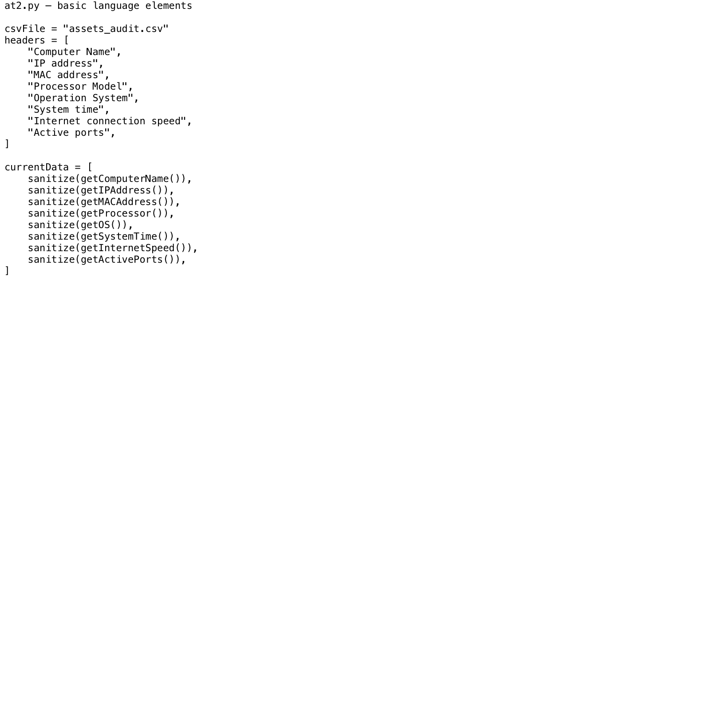
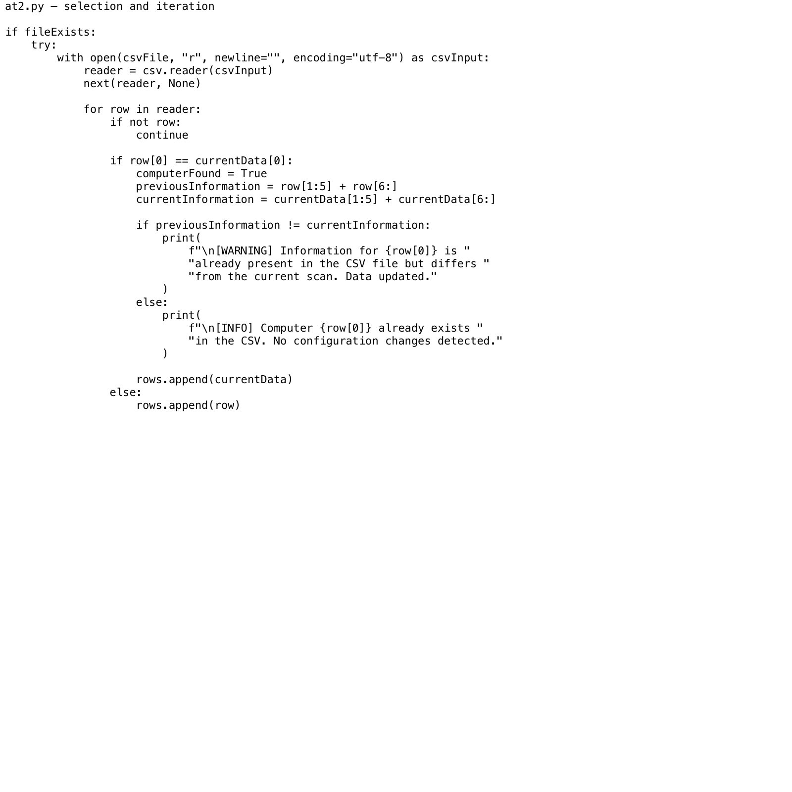
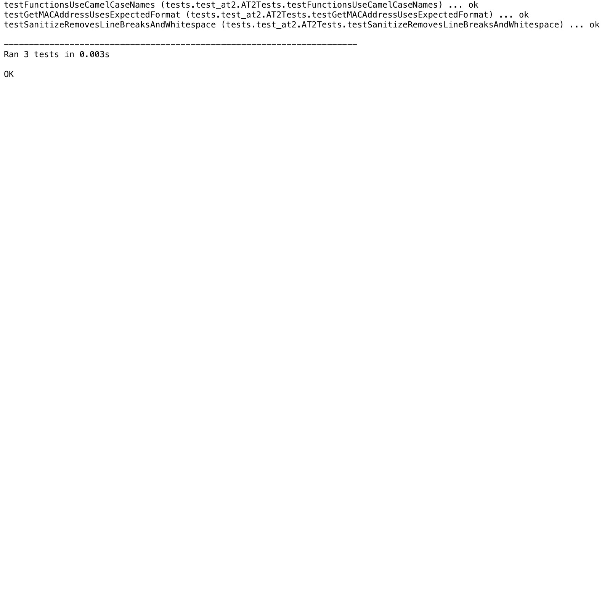
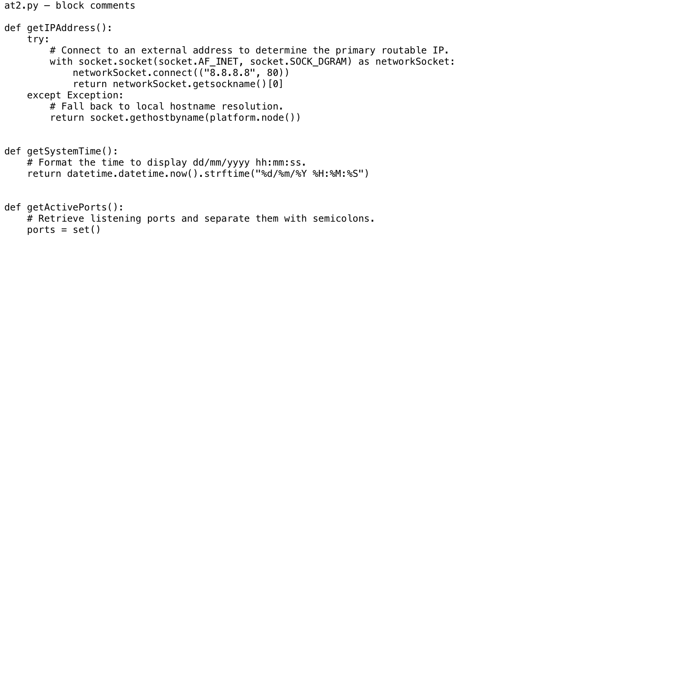

# AT2 questionnaire

## Selecting a Python framework and IDE

### Introduction

This project is an asset-audit script for Midtown IT. It collects details from Windows and Linux computers and stores them in `assets_audit.csv`. The project requirements specify Python 3.11 and do not allow extra third-party software libraries.

For that reason, I selected the Python 3.11 standard library rather than an application framework such as Django or Flask. A web framework would add installation, security, and maintenance work without helping a portable command-line audit script. The standard library already supplies the required modules for CSV files, operating-system details, networking, dates, subprocesses, downloads, and testing.

### a) Python characteristics, protocols, and object model

Python is a high-level, general-purpose language that works well for scripting. Its main characteristics are:

- Python normally runs through an interpreter, so a script can be tested without a separate compilation stage.
- Its syntax is designed to be readable. Indentation marks code blocks instead of braces.
- It uses dynamic typing. A variable refers to an object and does not need a declared type, although the object's type still controls which operations are valid.
- It supports procedural, object-oriented, and functional programming styles.
- It includes a large standard library. This project uses `csv`, `datetime`, `os`, `platform`, `socket`, `subprocess`, `time`, `urllib.request`, and `uuid`.
- It runs on Windows, Linux, and macOS. Platform-specific commands still need separate handling, as shown in `getProcessor()` and `getActivePorts()`.
- Exceptions allow a script to respond to failed network, file, or operating-system operations without ending unexpectedly.

Python's object model treats every value as an object. Each object has an identity, a type, and a value. Variables hold references to objects rather than containing the objects themselves. Classes define behaviour, objects are instances of classes, and inheritance can reuse or extend that behaviour. Mutable objects, such as lists and sets, can change after creation. Immutable objects, such as strings, integers, and tuples, cannot.

Python protocols define behaviour through recognised methods rather than requiring a formal interface declaration. Relevant examples include:

- The iteration protocol lets a `for` loop request items from a collection one at a time.
- The sequence protocol supports indexed access and slicing, such as `row[1:5]`.
- The context-manager protocol controls setup and cleanup in a `with` statement. The script uses it to close files, sockets, and network responses correctly.
- The callable protocol allows functions such as `sanitize()` to be called with arguments.
- The mapping and container protocols support key lookup, membership tests, and collection operations where required.

### b) IDE selection and manager communication

I selected PyCharm because the project already contains a `.idea` project configuration. PyCharm provides Python-aware breakpoints, step controls, variable inspection, watches, an expression evaluator, syntax checking, refactoring tools, an integrated terminal, and `unittest` integration. These tools are suitable for tracing the CSV update logic and checking platform-dependent branches.

PyCharm also lets the project interpreter be set to Python 3.11, matching the brief. The current `.idea/misc.xml` refers to Python 3.14, so the interpreter must be changed to Python 3.11 before final compatibility testing. Visual Studio Code was considered, but it needs separate Python extensions and more manual setup. IDLE is included with Python but has fewer project, refactoring, and test-management features.

#### Email requesting confirmation

**To:** Midtown IT Manager  
**From:** Cybersecurity Specialist  
**Date:** 14 October 2026  
**Subject:** Approval request for Python framework and IDE

Hello,

I recommend using Python 3.11 with its standard library and PyCharm for the asset-audit project. The script is a portable command-line tool, so it does not need a web or desktop application framework. The standard library meets the brief without adding third-party dependencies and provides the CSV, networking, operating-system, date, subprocess, download, and testing functions needed by the script.

I selected PyCharm because it supports breakpoints, step-by-step debugging, variable inspection, code refactoring, and `unittest` execution in one application. The repository also already contains PyCharm project files. I will configure the project to use Python 3.11 before the final compatibility test.

Please confirm whether I may use Python 3.11, the Python standard library, and PyCharm for this work.

Regards,  
Cybersecurity Specialist

**Confirmation status:** Awaiting the manager's response. This field must be updated when written confirmation is received.

## Translating pseudocode into scripts

### a) Basic language elements and data

The selected code creates a string variable called `csvFile` and two lists called `headers` and `currentData`. Each item in `currentData` is a string returned by a collection function and cleaned by `sanitize()`. A list is appropriate because CSV columns have a fixed order and `csv.writer` accepts an ordered sequence.



Source: `at2.py`, main function.

### b) Selection and iteration

The script uses `if` statements for decisions and a `for` loop to process the saved records. `if fileExists` avoids trying to open a missing file. The `for row in reader` loop is efficient because it reads each CSV record once rather than repeatedly searching the file. `continue` skips an empty row immediately. The nested selection then decides whether to replace the matching computer record or preserve a record belonging to another computer.

This control flow has linear time complexity, written as O(n), where n is the number of saved computer records. A single pass is simpler and uses less work than running separate searches for matching and non-matching records.



Source: `at2.py`, CSV read and comparison block.

## Debugging and testing

### a) Testing process

I used the project's `unittest` suite. The repeatable test command was:

```text
python3 -m unittest discover -s tests -t . -v
```

The process was:

1. Open the project in PyCharm and select a Python 3.11 interpreter.
2. Set breakpoints at the start of `main()`, inside the CSV loop, and in each exception handler.
3. Run the `tests` folder with PyCharm's `unittest` runner.
4. Use Step Into for calls such as `sanitize()` and Step Over for standard-library calls.
5. Inspect `currentData`, `row`, `computerFound`, `previousInformation`, and `currentInformation` in the debugger.
6. Confirm the automated assertions and compare the actual results with the expected results.
7. Record any untested branches or incorrect behaviour in the report below.

The automated suite was also run from the terminal on 14 October 2026. All three tests passed.



### Testing report

| Test | Expected result | Actual result | Status |
| --- | --- | --- | --- |
| Sanitise line breaks and surrounding spaces | `"  first\nsecond\r  "` becomes `"first second"`. | Returned `"first second"`. | Pass |
| Format a known MAC address | `0xAABBCCDDEEFF` becomes `AA-BB-CC-DD-EE-FF`. | Returned the expected address. | Pass |
| Check function naming | No function name contains an underscore. | No invalid function names were found. | Pass |

### b) Omissions and errors

The current test suite is useful but small. It does not yet test:

- Primary IP detection or hostname fallback.
- Windows and Linux processor collection.
- Date and time formatting.
- Successful, zero-duration, offline, and timed-out internet-speed checks.
- Windows and Linux active-port parsing.
- Creating a new CSV file.
- Adding a new computer, updating a changed computer, or retaining an unchanged computer.
- Empty rows, malformed rows, duplicate computer records, read failures, or write failures.
- Execution with the required Python 3.11 interpreter.
- A complete run on both Windows and Linux hardware.

The review also found these errors or mismatches:

- `sanitize()` removes line breaks but does not prevent spreadsheet formula injection. Values beginning with `=`, `+`, `-`, or `@` still need handling before they are written to CSV.
- If the existing CSV file cannot be read, `at2.py` continues and may overwrite it with only the current computer. The amended pseudocode correctly stops after a read failure, but the script does not yet match it.
- The internet-speed request uses plain HTTP. HTTPS would protect the download from alteration in transit if the selected test service supports it.
- `getActivePorts()` silently returns an empty or partial result after an error. The program does not tell the user that port collection failed.
- The PyCharm project is currently configured for Python 3.14, while the project brief requires Python 3.11.

## Internal documentation

The project guideline requires clear block comments written as full sentences. It discourages inline comments. The selected comments describe why the code uses an external address, when it falls back to hostname resolution, how it formats the system time, and what the active-port function collects.



### Communication log

| Date | Participants | Method | Topic | Outcome and action |
| --- | --- | --- | --- | --- |
| 14 October 2026 | Cybersecurity Specialist and Midtown IT Manager | Email drafted | Approval for Python 3.11, the standard library, and PyCharm | Awaiting confirmation. Configure PyCharm for Python 3.11 after approval. |
| 14 October 2026 | Cybersecurity Specialist and Midtown IT Manager | Discussion to be scheduled | Test omissions and errors found during review | Present the missing test coverage and five code issues listed above. Record the manager's priorities, owner, and due date after the discussion. |

No manager response or meeting record was present in the project folder. The log therefore records these items as pending rather than claiming that approval or discussion has already occurred.

## Item manipulation

The script uses list slicing and concatenation to build two comparable configuration records:

```python
previousInformation = row[1:5] + row[6:]
currentInformation = currentData[1:5] + currentData[6:]
```

This is an example of item manipulation because it selects ranges of items from each list and joins those ranges into new lists. Index `0`, the computer name, is omitted because it has already been used to identify the matching record. Index `5`, the system time, is omitted because it changes on every run and would otherwise create a false configuration warning.

List slicing is concise and does not change the original records. It also lets the script compare the remaining fields with one equality operation instead of writing a separate comparison for every column.

## Evidence files

- `evidence/basic-language-elements.txt.png`
- `evidence/selection-and-iteration.txt.png`
- `evidence/test-results.txt.png`
- `evidence/block-comments.txt.png`
- `evidence/test-results.txt`, containing the captured test output.

The code screenshots were rendered from exact excerpts of `at2.py`. The test screenshot was rendered from the captured command output. A final submission should also include a PyCharm debugger screenshot showing a paused breakpoint and the Variables panel, because this environment could not open the interactive IDE session.
