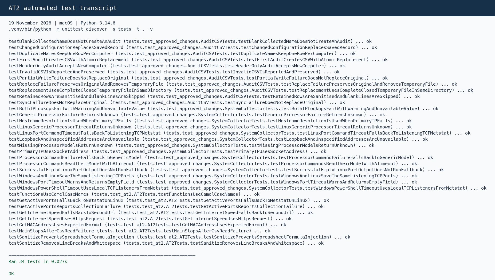

# Midtown IT Asset Audit Testing Report

**Test date** 19 November 2026  
**Implementation** `src/pycharm_project_at2/at2.py`  
**Environment** macOS, Python 3.14.6  
**Result** 34 passed, 0 failed. Standard-library `trace` measured 95.8% line coverage in `at2.py`.

## Testing process

David Hunt approved the changes in his 18 November 2026 UTC reply. The pseudocode was revised before the corresponding code edits. The nine existing tests passed at baseline. The new tests reproduced the original validation, duplicate, write and collector gaps before the fixes. A follow-up test run also confirmed the initial failures for unusable IPv4 addresses, Windows port fallback and the bounded Linux processor fallback before those refinements.

From the project root:

```text
python3 -m unittest discover -s tests -t . -v
```

The run used the project interpreter at `.venv/bin/python`. The test suite covers individual collectors and calls `main()` end to end using mocked system values and disposable local CSV files. File writes and successful replacements operate on those real temporary files. Command output, timeouts, network lookups and write failures are simulated. The project audit CSV was left intact. The audit script and tests use only Python standard-library imports.

Coverage was measured with `python3 -m trace --count --missing --summary --coverdir /tmp/at2-coverage --module unittest discover -s tests -t .`. The reported percentage is for the audit module's executable lines.

## Approved requirements and automated results

| Requirement | Automated checks in `tests/test_approved_changes.py` | Result |
| --- | --- | --- |
| Validate the CSV | Reject empty files, incorrect headings, short or long rows, blank names, malformed quoting and invalid encoding. Preserve rejected input byte for byte. Accept a header-only file and optional UTF-8 BOM, skip blank lines, and sanitise retained cells. Reject a blank collected name. | Pass |
| Handle duplicate names | Treat case variants as the same computer. Keep the first saved row for another computer and save the current computer once. Verify that a timestamp-only difference reports no change and an IP change reports an update. | Pass |
| Handle failed IP resolution | Use the primary IPv4 address when available, try hostname resolution after primary failure, and warn and record `Unavailable` if both methods fail or yield loopback or unspecified addresses. | Pass |
| Bound subprocess calls | Assert the five-second timeout on audit-launched commands. Simulate Windows and Linux processor and port timeouts, including the Linux generic processor fallback. | Pass |
| Fall back for the processor model | Exercise Windows and Linux command output, missing commands, command errors, blank models and timeouts. Verify the generic fallback and final `Unknown` value. | Pass |
| Collect comparable listening TCP ports | Windows listener output and Linux `ss` output produce the same sorted, unique ports. Windows and Linux `netstat` fallback fixtures exercise IPv4, IPv6 and state filtering. UDP, established connections and remote ports are excluded. | Pass |
| Replace the audit only after a successful write | Assert that the temporary file is in the destination folder, complete and closed before `os.replace()`. Verify atomic creation, no replacement on partial write or sync failure, and original-file preservation and temporary-file cleanup if replacement fails. | Pass |

The [full verbose test output](evidence/unit_test_results_current.txt) records all 34 results. The [rendered test transcript](evidence/unit_test_results_current.png) shows the same run. The November 12 CSV review and the earlier three-test images are historical evidence.



## Pending practical evidence

- **Three-computer Windows/Linux run.** Run the revised script sequentially on at least three distinct authorised computers or VMs covering Windows and Linux. Keep the actual console captures and resulting shared CSV. Verify collected values and demonstrate an unchanged repeat and a controlled configuration change.
- **PyCharm debugger capture.** Use disposable audit data. Pause after `currentData` is collected, at the matching branch in `prepareAuditRows()` and in a read or save error handler. Capture the paused source, Variables panel and test runner.
- **Final signoff.** Present the revised script, test evidence and practical run results to David Hunt once practical evidence is complete. His email approved the implementation changes.
